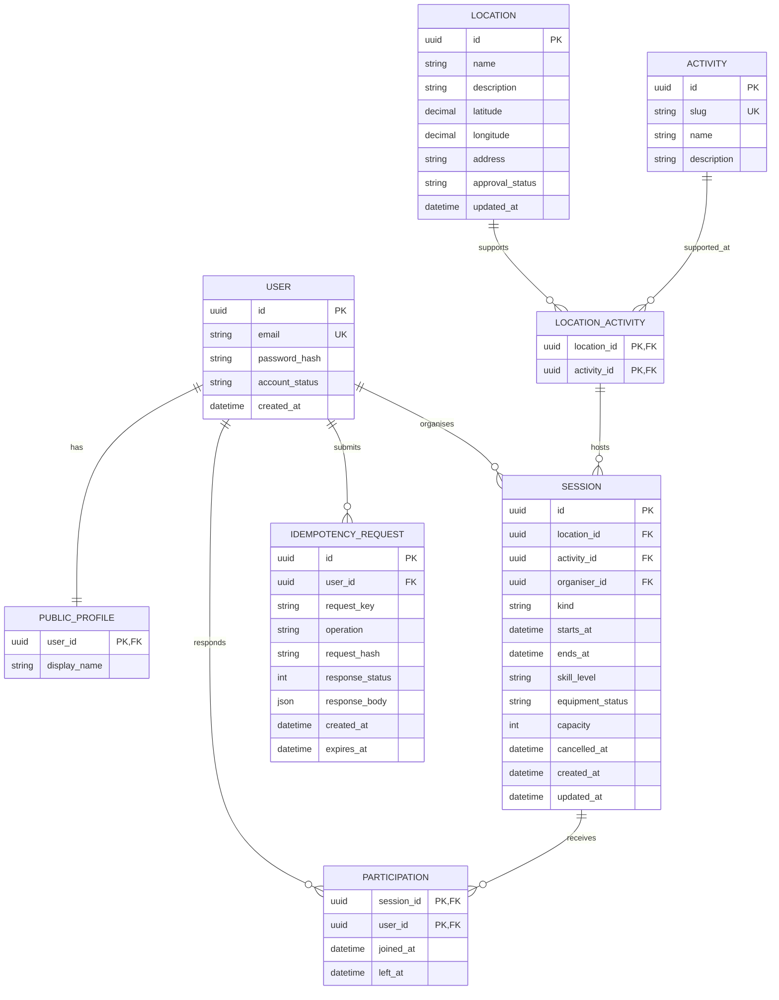

# SteamIRL: модель данных

Статус: реализованы Activity, аккаунты через ASP.NET Core Identity, PublicProfile, Location, LocationActivity, GameSession, Participation, IdempotencyRequest, LocationSubmission, SubmissionActivity, ContentReport и ModerationDecision с миграциями. Основание: заявление о дипломном проекте и `BA_Nikitsenkau_Aliaksei 2.docx`, прежде всего разделы 2.3–2.7 и Appendix A. Диаграмма ниже показывает модель первого этапа; расширение модерации описано далее и в [отчёте](moderation-verification.md).

## 1. Границы модели

Активность — единственная запись каталога, например «Волейбол». Локация — конкретное место, которое может поддерживать несколько активностей. Игровая сессия — приглашение на определённое время с количеством дополнительных игроков. Сообщение о присутствии — отдельное краткосрочное наблюдение о том, сколько людей уже играет.

Первый этап реализует аккаунты, каталог, чтение одобренных локаций, создание запланированных и немедленных сессий, участие и управление своей сессией. Помимо начальных данных теперь поддерживаются пользовательские предложения, исправления и модерация. Отзывы, фотографии и сообщения о присутствии остаются следующими этапами.

## 2. ER-диаграмма первого этапа

Диаграмма записана в Mermaid. Имена обозначают логические сущности, а не окончательные имена таблиц ASP.NET Core Identity.

`USER` содержит данные авторизации; фактическую схему и нормализацию email определяет ASP.NET Core Identity. `PUBLIC_PROFILE` хранит публичный псевдоним. Email, хеш пароля и служебные поля аккаунта никогда не включаются в публичный ответ API. Дату рождения для первого этапа собирать не требуется.

## 3. Ограничения и правила

### Каталог и локации — US03

- У активности уникальный нормализованный `slug`. Каталог управляемый: создание игры не создаёт новую активность.
- Первичный ключ `LocationActivity` — пара `(location_id, activity_id)`.
- Сессия ссылается составным внешним ключом на эту пару. Это предотвращает игру по активности, которую площадка не поддерживает.
- Широта находится в диапазоне −90…90, долгота — −180…180.
- Публичные запросы показывают только одобренные локации. Предлагаемые значения `approval_status`: `Pending`, `Approved`, `Rejected`, `Removed`.
- Физическое удаление локации или связи с активностью, пока на неё ссылаются игры, запрещено. `LocationActivity.IsEnabled` выключает активность без удаления внешнего ключа. Снятие локации или активности запрещает новые игры и вступления и отменяет соответствующие активные приглашения. Повторное включение активности не возобновляет отменённые игры.

### Игровые сессии — US08, US09, US11

- `kind`: `Planned` или `Immediate`.
- `capacity` — число **дополнительных** игроков: от 1 до 30. Организатор и его знакомые автоматически в это число не входят.
- `skill_level`: `Beginner`, `Intermediate`, `Advanced`.
- `equipment_status`: `BallAvailable`, `BallNeeded`, `NotSpecified`; по умолчанию последнее. Для активностей без мяча форма использует `NotSpecified`, пока отдельная модель инвентаря не понадобится.
- `ends_at > starts_at`. Все моменты времени хранятся как PostgreSQL `timestamptz`, передаются в API с часовым смещением и сравниваются на сервере. Интерфейс явно показывает часовой пояс площадки `Europe/Vilnius`.
- Для запланированной игры при создании начало должно быть в будущем. Для немедленной игры сервер задаёт начало сам; срок действия — 15 минут…4 часа, по умолчанию 1 час.
- Активный аккаунт может создать максимум три немедленных приглашения за скользящий час. Повтор запроса с тем же ключом идемпотентности не считается новым созданием.
- У организатора может быть только одно неотменённое и неистёкшее немедленное приглашение для пары «локация + активность». Заполненная игра тоже подпадает под запрет.
- Организатор может менять вместимость и отменять собственную неотменённую, неистёкшую игру. Новая вместимость не может быть меньше числа активных участников. Перенос времени, места и активности на первом этапе не поддерживается: для этого создаётся новая игра после отмены старой.

`created_at`, `starts_at` и `ends_at` не заменяют друг друга: время создания нужно, в частности, для ограничения частоты публикаций.

### Статусы и доступные места

Сохраняется факт отмены (`cancelled_at`), а публичный статус вычисляется в следующем порядке:

1. `Cancelled`, если игра отменена.
2. `Expired`, если `ends_at <= server_now`.
3. `Full`, если активных участников не меньше `capacity`.
4. `Open` в остальных случаях.

Активный участник имеет `left_at = null`. Число свободных мест равно `capacity − active_participation_count`. Отдельный изменяемый счётчик на первом этапе не хранится: это уменьшает риск расхождения данных.

Статус `Open` позволяет присоединиться как до начала запланированной игры, так и во время неё. Начало игры само по себе не закрывает набор. Полная игра снова становится открытой после выхода участника или увеличения вместимости, если она ещё действительна.

Проверка срока выполняется в запросах чтения и в транзакции вступления. Фоновая задача не является условием корректного истечения срока. Интерфейс обновляет данные максимум через 60 секунд при нормальном соединении и локально отключает кнопку вступления при достижении известного времени окончания.

### Участие и конкурентные запросы — US10

- Первичный ключ `(session_id, user_id)` запрещает дубли участия.
- Организатор не может вступить в свою игру. При необходимости он меняет количество требуемых игроков.
- Повторное вступление активного участника возвращает имеющееся участие и не занимает ещё одно место.
- Выход устанавливает `left_at`; повторный выход не меняет вместимость.
- Новое вступление после выхода переиспользует запись, обновляет `joined_at` и очищает `left_at`, если игра ещё допускает вступление.
- Вступление, выход, изменение вместимости и отмена блокируют одну и ту же строку `Session` через `SELECT … FOR UPDATE` в транзакции PostgreSQL. Подсчёт участников выполняется после получения блокировки. Все пути изменения участия обязаны соблюдать этот протокол.
- Проверка времени выполняется после получения блокировки по текущим часам БД, а не по времени начала ожидавшей транзакции. Это исключает вступление по устаревшей проверке после долгого ожидания блокировки.
- После блокировки сервер заново проверяет состояние аккаунта, доступность локации, отмену, окончание игры, существующее участие и свободные места. Только затем меняет данные.

Для нового вступления в заполненную, отменённую или истёкшую игру возвращается конфликт с кодом причины. Повтор уже выполненной команды с тем же ключом возвращает её исходный результат; свежий запрос карточки показывает актуальное состояние.

### Дубли создания и идемпотентность

При создании немедленного приглашения сервер сначала блокирует строку организатора. Под блокировкой проверяются лимит за час и наличие действующего приглашения, затем создаётся игра. Изменение данных и фиксация результата команды происходят в одной транзакции.

Простой уникальный индекс с условием `ends_at > now()` не подходит: течение времени не перестраивает индекс. На первом этапе запрет дублей реализуется транзакционным протоколом, который должны использовать все пути создания.

Для создания, вступления и выхода клиент передаёт `Idempotency-Key`. Уникальна пара `(user_id, request_key)`; запись содержит операцию, хеш параметров и результат. Тот же ключ с другими параметрами отклоняется. Параллельный дубль не выполняет команду повторно. При ошибке до фиксации транзакции не сохраняется успешный результат.

После сетевой ошибки клиент повторяет ключ исходного намерения. Для нового осознанного действия, например повторного вступления после выхода, создаётся новый ключ. Иначе запоздалый повтор старого запроса мог бы снова вступить в игру или выйти из неё. Предлагаемый срок хранения ключей — 24 часа; гарантия повтора ограничена этим сроком и должна быть отражена в контракте API.

### Индексы и удаление

Помимо первичных и уникальных ключей нужны индексы для локаций по статусу, сессий по активности/времени и локации/времени, игр организатора по времени создания и участия пользователя. Конкретный порядок колонок уточняется по запросам и планам выполнения.

Удаление аккаунта и судьба связанных материалов входят в US19 и проектируются до полного MVP. Нельзя каскадно удалять чужие участия вместе с организатором. На первом этапе публичное развёртывание с реальными пользователями не предполагается; проверка сценариев использует тестовые аккаунты.

## 4. Расширение до полного MVP

Уже реализованы сущности вкладов и модерации:

- `LocationSubmission` объединяет новые места и исправления: автор, ссылка на локацию, вид, состояние, базовая версия, исходный JSON-снимок, предложенные поля, источник/пояснение и время. Для нового места создаётся локация `Pending`; исправление не меняет публичные поля до одобрения. `SubmissionActivity` хранит предлагаемые активности с FK.
- `Location.Revision` начинается с 1 и увеличивается при публикации/снятии. Одобрение устаревшего исправления возвращает 409. Сведения, связи, время и решение обновляются в одной транзакции.
- `ContentReport` имеет ровно один FK: на локацию или игру. Частичные уникальные индексы запрещают повтор открытой жалобы одного автора на объект с той же причиной.
- `ModerationDecision` ссылается ровно на одно предложение или жалобу. Сохраняет модератора, действие, причину, время, JSONB-снимки до/после и число отменённых игр. По одному обращению принимается одно окончательное решение; повтор команды возвращает сохранённый результат.
- Роль `Moderator` существует в Identity, но не назначается автоматически. Проверки прав используют текущее состояние БД. Публичные DTO не содержат приватных жалоб или внутренних снимков аудита.
- Порядок блокировок: аккаунт → локация (`FOR SHARE` для команд игроков, `FOR UPDATE` для модерации) → игра/обращение. Затронутые игры блокируются в порядке ID. Одобрение точных дубликатов новых мест дополнительно сериализуется advisory-блокировкой по fingerprint и защищено уникальным индексом.

Остальные сущности и связь реализованных вкладов с будущими функциями:

| Сущность | Основные связи и назначение | Истории |
| --- | --- | --- |
| LocationSubmission (реализовано) | Объединённая модель предложения/исправления, защищённая версией и аудитом. | US05–06 |
| Review | Локация, автор, текст, время, состояние публикации. Оценка числом в BA не обязательна и пока не добавляется. | US07 |
| Photo | Локация, загрузивший пользователь, необязательный отзыв, ключ объекта в хранилище, формат, размер, состояние обработки/публикации. Если указан отзыв, он должен относиться к той же локации. | US07 |
| PresenceReport | Локация + активность, автор, неотрицательное число людей, серверное время наблюдения, истечение через 30 минут. Показывается последнее действующее сообщение; числа не суммируются. | US12 |
| ContentReport (реализовано для площадок/игр) | Для будущих отзывов/фото нужны типизированные FK и те же правила приватности и дубликатов. | US13 |
| ModerationDecision (реализовано) | Аудит рассмотрения предложений, исправлений и жалоб; расширяется на будущие типы материалов. | US14 |
| DataRequest | Владелец, запрос экспорта/удаления, состояние и даты обработки. | US19 |

Для жалоб и решений нужно сохранить внешние ключи: отдельные типизированные ссылки с проверкой «ровно одна цель» либо единая таблица модерируемых объектов. Произвольный `target_id` без ссылочной целостности не использовать.

Загрузка изображений должна проверять фактический формат и лимит 10 MB, удалять метаданные местоположения и публиковать только обработанный файл. Содержимое файлов хранится вне PostgreSQL; в базе находятся метаданные и ключи хранения.

После основного MVP добавляются предпочтения активностей (US15), личные записи времени (US16), правила и выдачи достижений (US17), AI-сводки со связями с исходными отзывами (US18), затем необязательные рекомендации (US20). Эти функции сохраняются в плане диплома.
