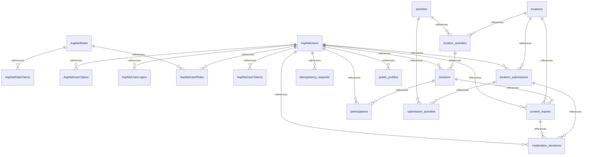

# Логическая схема реализованной БД

Схема связей реализованных таблиц после шести миграций. PK/FK и ограничения перечислены в [словаре данных](data-dictionary.md). Параллельные FK к одной таблице обозначают разные роли аккаунта. Планируемые функции описаны отдельно в [соответствии BA](ba-traceability.md).

Представления reporting не являются дополнительными хранилищами: account_directory читает AspNetUsers/public_profiles с полной маской email; location_catalogue читает locations/location_activities/activities; session_overview добавляет sessions/participations и вычисляет статус. Журнал __EFMigrationsHistory технический.
